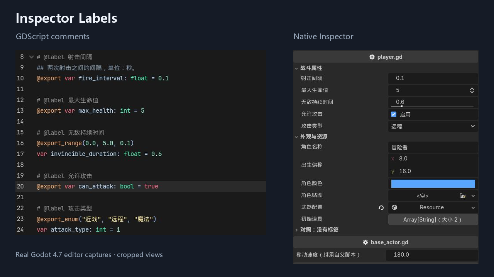

# Inspector Labels

[中文说明](README.zh-CN.md)

Set custom labels for GDScript exports with a `# @label` comment. Keep your variable names, saved property keys, and native Inspector controls unchanged.

```gdscript
# @label 射击间隔
@export var fire_interval: float = 0.1

# @label Maximum health
@export var max_health: int = 5
```



## Features

- Custom labels from comments above exported properties, including Chinese text.
- Native number fields, range sliders, checkboxes, enums, vectors, colors, resource pickers, and arrays.
- Labels inherited from parent scripts and labels on custom Resource exports.
- No `@tool` annotation required on game scripts.
- Ordinary `##` documentation comments remain available as Godot tooltips.
- Refresh after script saves or filesystem reloads; a manual refresh command is also provided.
- Disable the plugin to restore the original labels without changing property values.

## Installation

1. Copy `addons/inspector_labels` into your project's `addons` folder.
2. Enable **Inspector Labels** in **Project > Project Settings > Plugins**.
3. Add `# @label Your label` above an exported variable, save the script, and select the node.

The comment is plugin syntax, not a built-in GDScript annotation. The text is used literally; this is not an automatic translation service.

## Label rules

Put the comment on its own line at script top level. Blank lines, documentation comments and export annotations may appear between the marker and its variable.

```gdscript
# @label Invincibility duration
## Duration in seconds after taking damage.
@export_range(0.0, 5.0, 0.1)
var invincible_duration: float = 0.6
```

`## @label` is also accepted, but `# @label` is recommended to avoid putting the marker in a documentation tooltip. The last consecutive marker wins. Empty labels and unmarked properties use the native name. Labels are read from saved source files.

If the Inspector has not refreshed, reselect the node or use **Project > Tools > 刷新检查器中文标签** (Refresh Inspector Labels).

## Demo and tests

The full source package includes `project.godot` and `examples/demo.tscn`. Import the project, open the scene, and select **Player**. The main store ZIP contains only the installable addon and its standalone documentation.

On Windows, run `tests/run_tests.ps1 -Godot 'path-to-Godot-console.exe'`. Tests execute in an isolated project copy. 35 parser/resource checks and 30 editor integration checks passed on Godot 4.7, including edit, undo/redo, save/reload, plugin disable/enable, and comment-only external saves.

## Compatibility and limitations

- Tested on Windows with Godot 4.7. Pure GDScript; .NET is not required. Other operating systems have not been tested.
- Supports exported variables at script top level. C#, function locals, and variables declared inside nested `class Inner:` blocks are outside this release's scope.
- Does not translate built-in Godot properties, enum options, node names, or individual array elements.
- Other Inspector plugins that take over the same property may affect label display; combined compatibility is not guaranteed.

## Development disclosure

Developed with AI assistance using OpenAI Codex for implementation, documentation, tests, and release preparation. Tests were executed in Godot 4.7. Screenshots are captures of the running editor; the icon and promotional layout were drawn programmatically with AI-authored code.

## License

[MIT](LICENSE) © 2026 Soybean-milk.
